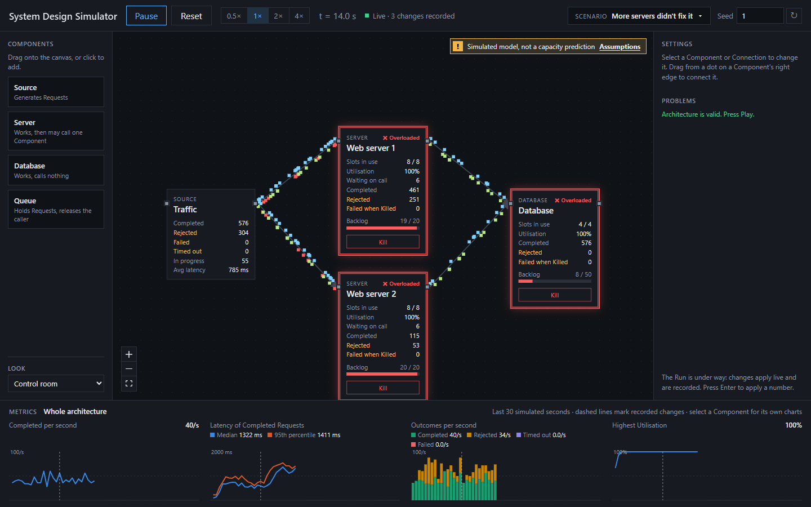
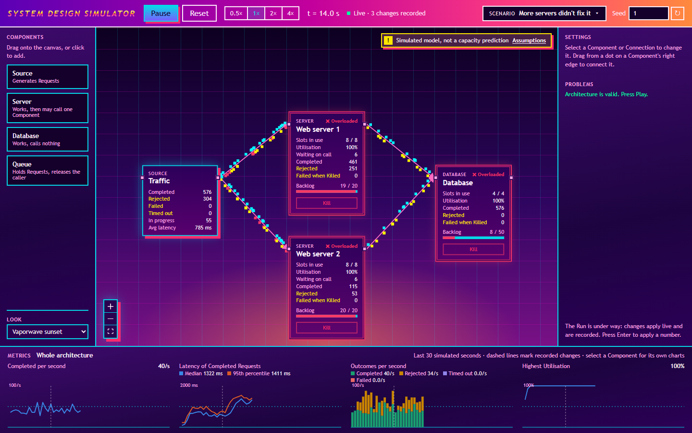

# System Design Simulator

Drag Sources, Servers, Databases and Queues onto a canvas, wire them into an architecture, and send simulated traffic through it. Requests move along the Connections, overloaded Components turn red, Backlogs fill up, and rolling charts show throughput, latency and Outcomes as they happen. Change anything mid-Run (raise the Rate, Kill a Server, put a Queue in front of slow work) and watch the consequences. Underneath is a small, deterministic discrete-event simulation engine, checked against textbook queueing formulas.

**Live:** LIVE_URL



## The headline demo: "More servers didn't fix it"

The default Scenario sends 66 Requests per second through a Web server to a Database that can only manage 40 per second. Because each Web server waits for its Database call to finish before it frees the slot (call-and-wait), the Web server fills up too and starts Rejecting Requests, so it looks like the problem. At 8 seconds a second Web server is added. Completed per second stays flat at about 40, because both Web servers are now waiting on the same Database. The bottleneck was never the Web tier.

The first-visit hint offers one-click ways to break it further: double the traffic, Kill the Database, or open "One server down".

## How the engine works

The engine lives in [`src/engine/`](src/engine). It is plain TypeScript with no React, DOM or wall-clock access, so it is easy to test and could move to a Web Worker.

- **Discrete-event simulation.** A priority heap holds future events (arrivals, work finishing, time limits) in simulated time, with ties broken by insertion order. The UI advances it to a target time in small chunks, within a 10 ms budget per animation frame. If it cannot keep up, the toolbar shows "Running behind" instead of freezing.
- **Call-and-wait.** A Request finishes only when its Source hears back. A Server works on it, calls one downstream Component (chosen round-robin), and keeps its Concurrency slot occupied until that call responds. That is why a slow Database saturates the Servers in front of it, and why a Queue, which releases its caller as soon as it accepts a Request, behaves so differently. See [ADR 0001](docs/adr/0001-requests-are-call-and-wait.md).
- **Seeded and reproducible.** All randomness (exponential gaps between Requests, exponential Work times) comes from one seeded generator. A Scenario is the starting architecture plus a seed plus a timeline of Interventions, so it always produces exactly the same Run. Scenarios save in the browser, export as JSON, and share as a URL that carries the whole Scenario in its fragment. Opening one replays every recorded change at its exact simulated time.
- **Verified against queueing theory.** A single Server is checked against M/M/1, Erlang C (M/M/c) and M/M/c/K over long seeded Runs. Measured Utilisation, time in Backlog, probability of waiting and share Rejected all land within a few percent of the closed-form answers. See [docs/engine-verification.md](docs/engine-verification.md).
- **Smooth canvas.** Components redraw their numbers a few times a second rather than every frame. All moving Requests are drawn from a capped sample by one layer outside React. The engine still simulates every Request. With 20 Components at 900 Requests per second and 4× speed, a frame costs under 1 ms on average.

## Assumptions

This is a simulated model, not a capacity prediction, and the app says so permanently in the corner of the canvas. Its Assumptions panel lists everything simplified on purpose:

- Connections are instant: no network delay. The dots are only a picture of the traffic.
- Killed Components are skipped instantly, with no health-check delay.
- No retries.
- Work times are exponentially distributed around the mean you set.
- A Server makes one downstream call per Request.
- Sources send at their Rate regardless of how the architecture copes.
- A Queue never redelivers a lost Request.
- Timed-out work carries on and its late response is ignored.
- Setting changes apply to future work only.
- No CPU, memory, caches, autoscaling or cold starts are modelled. Utilisation means busy Concurrency slots.

## Looks

One sober theme and five deliberately loud ones (Vaporwave sunset, Toxic spill, Bubblegum brutalist, Molten core, Y2K chrome), picked under "Look" at the bottom left. Status never depends on colour alone: each one has a symbol and a word as well.



## Running it locally

You need Node 24 or newer.

```bash
npm install
```

```bash
npm run dev
```

```bash
npm test
```

`npm run build` type-checks and writes a static site to `dist/`.

## Deployment

Every push to the main branch runs [`.github/workflows/deploy.yml`](.github/workflows/deploy.yml). It installs dependencies, runs the tests, builds with the base path set to the repository name, and publishes to GitHub Pages. A failing test stops the workflow before anything is built or deployed.

## Built with

Vite, React, TypeScript (strict), [React Flow](https://reactflow.dev) for the canvas, Zustand for UI state, and Vitest. There is no backend.
